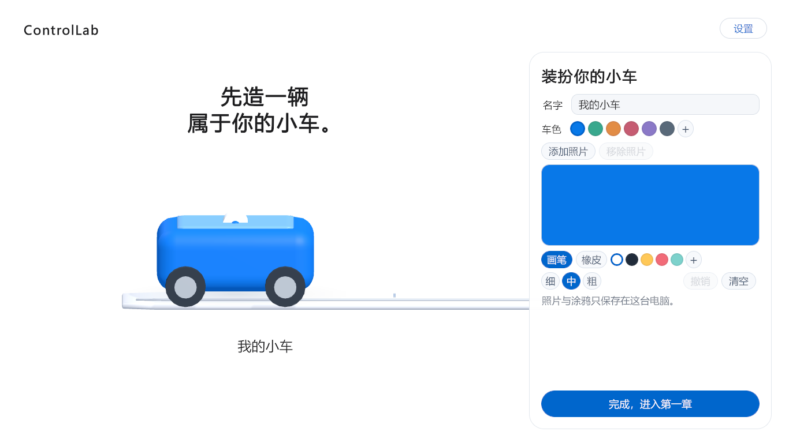
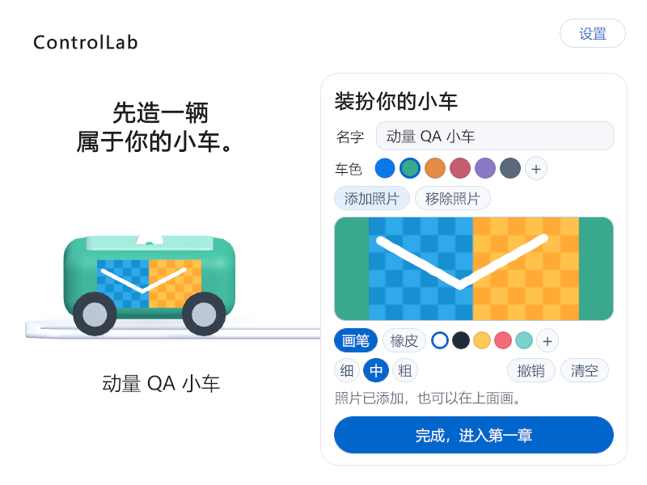
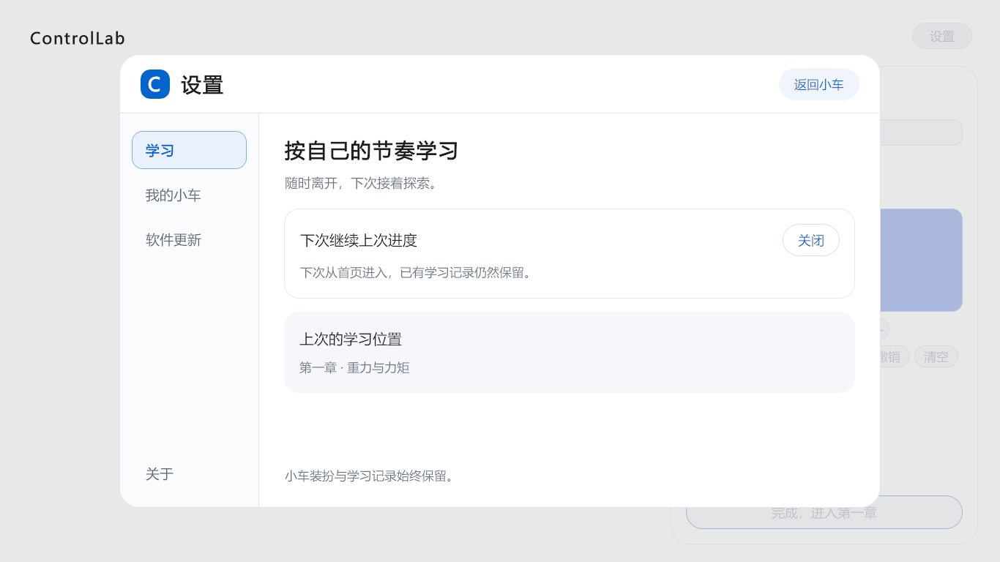
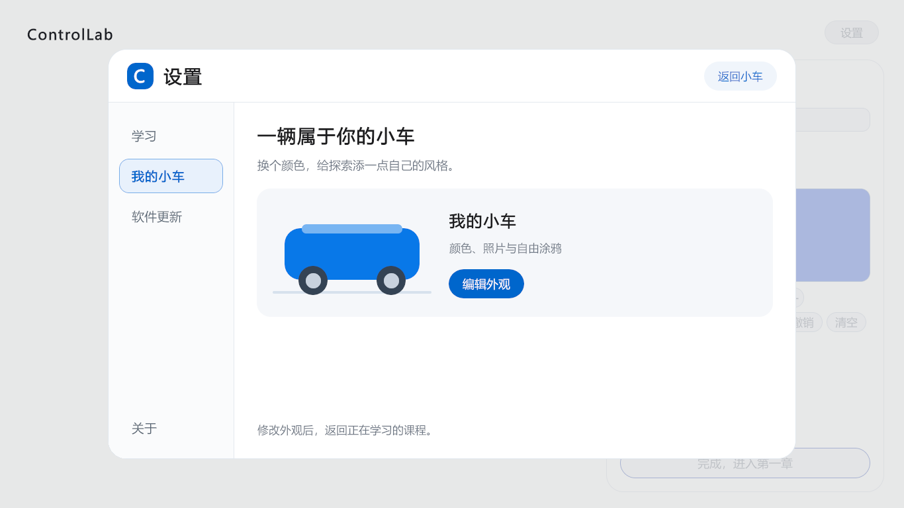
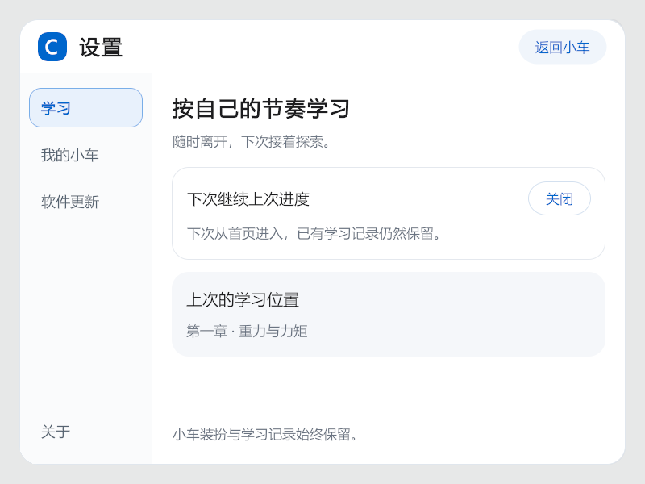
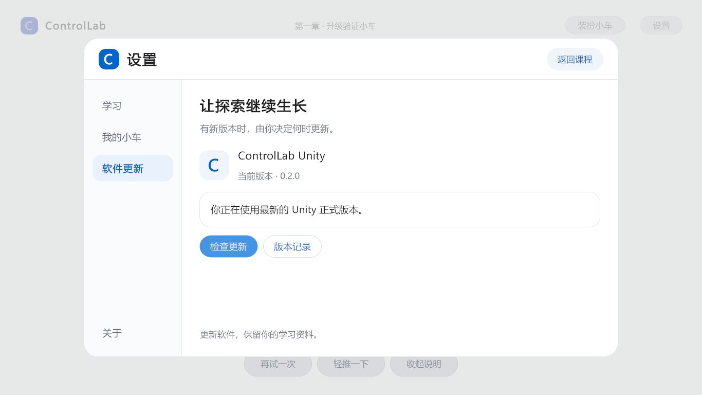
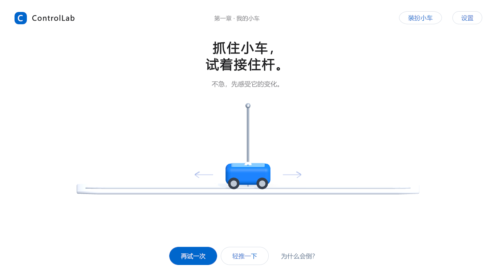
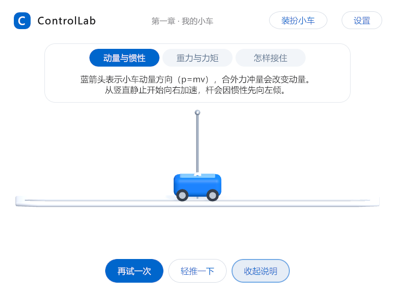
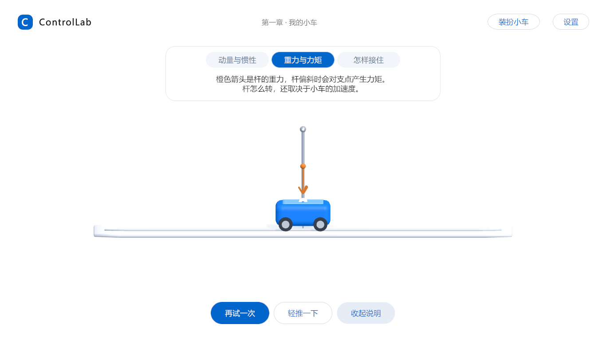

# ControlLab Unity · 小车装扮与第一章

首次打开时，先给自己的小车起名字、挑颜色、贴照片或自由涂画，再进入第一章。点击“完成，进入第一章”后，小车会从左侧平滑驶入中央，进入“抓住小车，试着接住杆”的自由探索。默认外观也可以直接完成进入。以后打开时，默认继续上次退出的页面与讲解。

当前版本 **0.2.0**，使用 Unity **6000.5.7f1**。设置已接入学习进度、小车外观、GitHub 更新三个页面和“关于”。工程同时包含 Windows Player、安装器构建与更新清单生成脚本。物理模型沿用已核验版本；本次功能和历史版本的验证范围分开记录，见 [验证记录](VALIDATION.md)。

## 直接体验

从 GitHub 下载 [Windows 0.2.0 安装包](https://github.com/Herd1s/Control_study/releases/download/unity-v0.2.0/ControlLab-Unity-Setup-0.2.0.exe)，安装后打开 ControlLab Unity。也可以下载 [完整便携 ZIP](https://github.com/Herd1s/Control_study/releases/download/unity-v0.2.0/ControlLab-Unity-Portable-0.2.0-windows-x64.zip)，完整解压后运行 `ControlLab Unity.exe`。版本说明与校验文件见 [正式 Release](https://github.com/Herd1s/Control_study/releases/tag/unity-v0.2.0)。运行软件不需要 Unity Editor、Python 或 .NET SDK。

1. 打开安装好的软件。开发者已有本地构建时，也可双击本目录的 **`Start-Prototype.cmd`**，或打开 `Builds/Windows/ControlLab Unity.exe`。
2. 在首页选择车色、输入名字；也可以添加照片，并在右侧画布上画出自己的车身皮肤。
3. 点击“完成，进入第一章”。约 2.6 秒的入场动画后，小车停在中央，杆竖直静止。
4. 抓住小车左右拖动，松手观察；倒下后重新抓住小车，就会在当前位置扶正并开始新一轮。

## 我的小车



- **车色与名字**：预设色可以直接选择，“＋”打开系统自选颜色；左侧实车预览即时更新。
- **照片**：点击“添加照片”选择本机 PNG/JPEG，图片完整缩放到车侧，不裁掉人物；移除照片会保留涂鸦。
- **自由绘画**：画笔和橡皮、不同粗细、预设或自选笔色；支持 20 次会话内撤销。“清空”只清空涂鸦，并且可以撤销。
- **完成与继续**：完成时一起保存名字、颜色、照片和涂鸦；正常退出或切换到其他窗口时也会保存未完成的装扮。第一章右上角“装扮小车”，或“设置 → 我的小车 → 编辑外观”，都可以返回修改。
- **课程中换肤**：点击“保存并返回课程”，直接回到原讲解和原实验；保留小车位置、速度、杆角度与实验时间，不重复播放首次入场动画。编辑期间暂停实验。

照片与涂鸦分层保存，下面使用自动生成的测试图片和笔迹展示实际效果：



照片只在本机读取与处理，不上传网络。支持文件不超过 8 MB、总像素不超过 1600 万且单边不超过 8192 的 PNG/JPEG；保存时统一为 512×192 皮肤图层，不保留原照片路径及图片元数据。资料默认位于 Windows 当前用户的 `AppData/LocalLow/ControlLab/ControlLab Unity/garage/cart-profile.json`，与工程和安装文件分开保存。

入场阶段是一段外观动画，不启动控制实验，也不用于评价平衡能力。到达中央后，物理状态才重置为第一章的初始状态。

## 设置与继续学习

首页和第一章右上角都能打开 **设置**。选择“学习”“我的小车”“软件更新”完成对应操作；“关于”提供版本与 GitHub 项目入口。窗口使用圆角卡片与短淡入，主要操作在 800×600 和 1366×768 中无需滚动。打开设置暂停当前实验与入场动画；点击“返回课程”“返回小车”或按 Esc 关闭后继续。

在 **学习 → 下次继续上次进度** 中切换，开关立即保存，默认开启。



- **开启**：下次继续退出前的页面；第一章还会恢复讲解主题和展开状态。
- **关闭**：下次从装扮首页开始，原课程记录与小车外观仍保留。关闭后再开启不会清空课程；只停留在首页并退出，也不会覆盖原课程记录。
- **重启后继续**：恢复学习位置，小车居中、杆竖直静止，等待操作，不恢复退出瞬间的运动状态。首次入场动画中退出，下次直接进入第一章。
- **编辑中退出**：正常退出会保存尚未点“完成”的装扮；课程中换肤时退出，下一次按开关选择继续原课程或进入首页，不会把皮肤编辑页误记成课程位置。



800×600 小窗口中，设置导航和操作保持完整可见：



以下三个文件分别保存在当前用户的 `AppData/LocalLow/ControlLab/ControlLab Unity/garage`，更新程序文件时不覆盖它们：

| 文件 | 内容 |
| --- | --- |
| `app-preferences.json` | “下次继续上次进度”开关 |
| `learning-progress.json` | 上次课程页面、讲解主题与展开状态 |
| `cart-profile.json` | 名字、车色、照片与涂鸦 |

偏好和课程记录使用原子替换、备份与损坏恢复。首次升级会迁移旧进度文件里的开关，新偏好文件随后成为开关的独立来源；旧记录中的兼容字段不会决定是否保存课程。损坏的文件会提示并优先读取有效备份，读取时不覆盖原始坏文件。当前可恢复的课程范围是装扮页与第一章。

## 在软件中更新

**0.2.0 是首个 Unity 正式发行版。** 历史 Unity 0.1.0 原型未内置本次更新器，请先手动下载安装 0.2.0；原 Unity 装扮和课程记录保留在同一用户目录中。旧 Python/Qt 版使用独立更新通道，也需首次手动安装 Unity，旧版课程代码和学习记录不会自动迁入。以下流程用于 0.2.0 及之后版本获取后续更新。

进入 **设置 → 软件更新 → 检查更新**，从 [Herd1s/Control_study](https://github.com/Herd1s/Control_study) 查询公开 Unity 正式版本。只有手动点击才会联网，不要求学生登录 GitHub。打开设置本身不会检查或下载。

1. 找到较新版本后，点击“下载更新”。界面显示下载进度，可以取消；关闭设置也会取消进行中的检查或下载。
2. 下载完成并通过文件大小与 SHA256 校验后，点击“安装并重新打开”。软件先保存装扮与学习位置，再退出并交给安装器。
3. 安装器等待旧程序退出、替换程序文件并重新打开软件。学习资料位于独立的用户目录，继续按原来的设置恢复。若保存失败，软件不会进入安装流程。

更新器只接受 `unity-vX.Y.Z` 的正式发布、对应 Unity 安装器和 `unity-update.json`；草稿、预发布及旧 Python 版本会忽略。0.2.0 已正式发布；当可查询的发布列表没有符合要求的 Unity 版本时，才显示“尚无 Unity 正式安装包”。网络不可达、限流或清单校验错误会单独提示，不表示“已经最新”。在线升级的实际验收范围见 [验证记录](VALIDATION.md)。

本次已用专用低版本验证客户端完成真实 GitHub 下载、安装、自动重启及资料保留检查，详见 [验证记录](VALIDATION.md)。下面是升级后的正式 0.2.0 再次检查的实际界面：



## 第一章

实验台保留三个主要操作，右上角可以返回装扮：

| 操作 | 行为 |
| --- | --- |
| 再试一次 | 回到中央，杆严格竖直，等待拖动 |
| 轻推一下 | 施加短暂的向右推力，观察杆如何变化 |
| 为什么会倒？ | 任选“动量与惯性”“重力与力矩”“怎样接住”，再次点击收起 |

没有课程过关检查，也不需要点击“开始”或“暂停”。本轮只做第一课，没有下一课入口。

下面是本机 Windows 程序实际渲染的画面。



800×600 小窗口中，说明按需替换顶部引导，实验台和底部操作保持可见：



三个物理主题可以随时切换，实验继续运行。蓝色箭头表示小车动量方向，静止时隐藏；橙色点标出杆的质心，重力箭头随杆移动并始终竖直向下。教学解释与可选实验见 [高中物理说明](Documentation/PHYSICS_EXPLANATION.md)。



## 打开 Unity 工程

本机 Unity 已能通过许可证检查。双击 **`Open-Unity.cmd`**，等待导入完成，再点击 Unity 顶部的 **▶ Play**。画面在 Game 窗口出现；Scene 窗口在运行前只显示入口对象，是因为实验台由代码生成。换开发机器时，需要先在 Unity Hub 激活适用的 Editor 许可证。

如果从 Unity Hub 打开：选择 Add → 从磁盘添加项目，选中本目录；导入后从顶部菜单 **ControlLab → Open first lesson** 打开场景，再按 Play。

如果 Unity 安装在别的位置，可运行：

```powershell
powershell -NoProfile -ExecutionPolicy Bypass -File .\Open-in-Unity.ps1 -UnityEditorPath 'D:\Unity\6000.5.7f1\Editor\Unity.exe'
```

脚本也支持环境变量 `UNITY_EDITOR_PATH`。优先使用工程记录的 6000.5.7f1；本轮没有验证其他版本。

## 在 VS Code 中修改

在 VS Code 打开本目录，主要修改以下文件。保存后切回 Unity，等待编译结束，再按 Play 查看。修改 UI 和场景代码不需要运行 Python。

也可以从 VS Code 的“终端 → 运行任务”选择打开第一课、源码检查、Windows 构建、生成安装包或检查更新流程；`Ctrl+Shift+B` 对应 Windows 构建任务。打开和构建需要已激活的 Unity，源码类型检查不需要启动 Editor。

| 文件 | 职责 |
| --- | --- |
| `Assets/ControlLab/Scripts/LessonOneExperience.cs` | 场景、灯光、鼠标交互、文案、按钮和画面更新 |
| `Assets/ControlLab/Scripts/LessonOneExperience.Welcome.cs` | 装扮、自动驶入、第一章三种状态；车侧贴图与外观应用 |
| `Assets/ControlLab/Scripts/LessonOneExperience.Settings.cs` | 设置、启动恢复、保存时机与更新流程；实验在设置期间暂停 |
| `Assets/ControlLab/Scripts/SettingsPanel.cs` | 学习、小车、更新和关于的布局、状态与按钮 |
| `Assets/ControlLab/Scripts/AppPreferencesStore.cs` | 独立开关偏好、旧格式迁移、原子写入与备份恢复 |
| `Assets/ControlLab/Scripts/LearningProgressStore.cs` | 课程位置、主题和展开状态；校验、原子写入与备份恢复 |
| `Assets/ControlLab/Scripts/UnityUpdateService.cs` | GitHub 更新状态、下载校验、取消与安装交接 |
| `Assets/ControlLab/Scripts/AppVersion.cs` | Player、设置与安装包共用的版本、产品及仓库常量 |
| `Assets/ControlLab/Scripts/CartStudio.cs` | 装扮面板、照片与涂鸦合成、完成保存 |
| `Assets/ControlLab/Scripts/SkinPaintCanvas.cs` | 自由绘画、笔刷、橡皮与撤销 |
| `Assets/ControlLab/Scripts/CartProfileStore.cs` | 图像验证、缩放、装扮保存与恢复 |
| `Assets/ControlLab/Scripts/NativeImagePicker.cs` | Windows 本机图片和颜色选择器 |
| `Assets/ControlLab/UI/Resources/LessonOne.uss` | 字号、留白、圆角、按钮反馈和小窗口布局 |
| `Assets/ControlLab/UI/Resources/Settings.uss` | 设置导航、卡片、圆角按钮与小窗口布局 |
| `Assets/ControlLab/Scripts/PendulumModel.cs` | 独立 C# 倒立摆模型、拖动辅助和状态切换 |
| `Assets/ControlLab/Scenes/LessonOne.unity` | 第一课入口场景 |
| `Assets/ControlLab/Editor/PrototypeBuilder.cs` | 项目配置、打开场景、Windows 构建 |
| `Assets/ControlLab/Editor/ConfigureUIPanel.cs` | 生成包含文字渲染资源的持久化 UI 面板，避免构建后界面缺失 |
| `Assets/ControlLab/Editor/PhysicsVerification.cs` | 对照冻结参考数据逐操作核验实际 C# 物理模型 |

物理状态与显示分开：固定每 0.02 秒更新物理，小车和杆显示当前状态；淡入、悬停和按下动效只影响界面与外观。运行时使用系统中文字体，不把 Windows 字体文件复制到工程中。基础依赖来自 Unity 自带模块，没有第三方模型或插件。

## 修改后重新构建

先关闭此工程的 Unity 编辑器和正在运行的原型，再双击 **`Build-Windows.cmd`**。也可以在编辑器中选择 **ControlLab → Build first lesson for Windows**。

成功后双击 **`Start-Prototype.cmd`**。输出位置是：

```text
Builds/Windows/ControlLab Unity.exe
```

给其他人以便携方式试用时，要发送**整个 `Builds/Windows` 文件夹**，包括 `_Data`、DLL 和运行时文件；也可以使用下面生成的安装器或便携 ZIP。体验者运行构建好的程序不需要安装 Unity Editor。

构建脚本会等待 Unity 真实退出并检查成功标记；失败时提示日志位置，不把旧 EXE 当作本次构建成功。

## 生成安装包与发布更新

开发机准备 Unity 6000.5.7f1 和 Inno Setup 6，在工程目录运行：

```powershell
powershell -NoProfile -ExecutionPolicy Bypass -File .\Build-Installer.ps1
```

脚本先构建 Player，再生成 `Builds/Releases/0.2.0` 下的安装器、完整便携 ZIP、`unity-update.json` 和 `SHA256SUMS`。已经完成当前版本的 Player 构建时，可加 `-SkipPlayerBuild`；脚本仍核对产品、版本和实际程序集哈希，防止旧 Player 被误标成新版本。Inno Setup 不在默认位置时传入 `-Iscc 'C:\完整路径\ISCC.exe'`。

安装器默认安装到 `%LOCALAPPDATA%\Programs\ControlLabUnity`，使用与旧 Python 软件不同的产品标识。软件卸载清理程序文件，保留用户资料。维护下一版本时，先修改 `AppVersion.Current`，完成构建与验证，再把同一版本的安装器和更新清单上传到 GitHub 的 `unity-vX.Y.Z` 正式 Release。生成文件的脚本不会自动上传或发布。

安装交接、发布资产要求和重复验证命令见 [Windows 安装与发布](Packaging/Windows/README.md)。

## 独立工程与后续课程

Unity 是目前唯一保留的开发工程。旧版 Python/Qt 应用工程、发布包及其开发环境已退役清理，不再作为启动、构建或验证的依赖。本目录可以单独用 Unity Hub 或 VS Code 打开。Git 仓库继续用于后续 Unity 开发与发布；旧版 Git 历史保留，Unity 从独立的 `unity-v0.2.0` 标签开始正式发行。

第一课物理模型最初由旧版 `free-exploration-v1` 移植为独立 C# 实现。松手保留惯性；抓取倒下的小车开始新回合；“再试一次”回中并将角度和速度清零。手动辅助属于自由体验，不等同于后续受推力限制的 PID/RL 评分任务。

保留的数值参考位于 `Tools/PhysicsCheck/Fixtures/physics-golden.json`，来自退役前实际运行的 Python 模型，附带来源信息与文件哈希；它是冻结测试数据，不包含旧应用源码或环境，也不会重新生成 Python 结果。现有 C# 模型可独立逐操作重放这份参考。源码和 UI 验证结果统一保存在本目录 `Logs/Verification`，其中迁移前报告记录的旧绝对路径属于历史取证信息。

源码检查和 Windows 构建只需要适用的 Unity 安装。可选的 Windows UI 自动检查使用系统 Python 与标准库；独立数值检查另需 .NET SDK，命令见 [验证记录](VALIDATION.md) 和 [物理核验工具](Tools/PhysicsCheck/README.md)。运行普通软件不需要安装 Python 或 .NET SDK。

学生 Python 编程、PID、强化学习、TITA 和后续课程尚未在 Unity 中实现。之后需在 Unity 工程内重新设计课程数据与控制接口，再单独实现并验证；不能把历史 Python 课程数量视为当前 Unity 已支持的课程。

最初的布局与流程讨论保留在 [设置界面交互草案](Documentation/settings-design.html)。学习、小车、更新设置及课程中换肤返回现已接入；当前运行行为和发布要求以本说明、代码及验证记录为准。

## 上传 GitHub 时

仓库当前以 `unity-prototype` 为唯一应用工程。保留 `Assets` 下的 `.meta` 文件；它们保存场景与脚本的引用关系。工程的 `.gitignore` 已排除 Library、Temp、Logs、Builds 等生成目录。冻结物理参考保存在 `Tools` 中，可随源码检出；日志和运行截图则属于本机验证产物。旧版 Python 发布工作流不再用于本工程，Unity 使用独立的安装包、清单和 `unity-vX.Y.Z` 发布标签。[Unity 0.2.0](https://github.com/Herd1s/Control_study/releases/tag/unity-v0.2.0) 已发布，后续修改应使用新版本号重新构建与验证。
